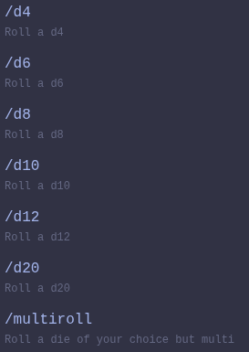
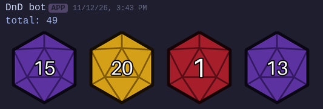
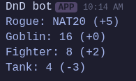
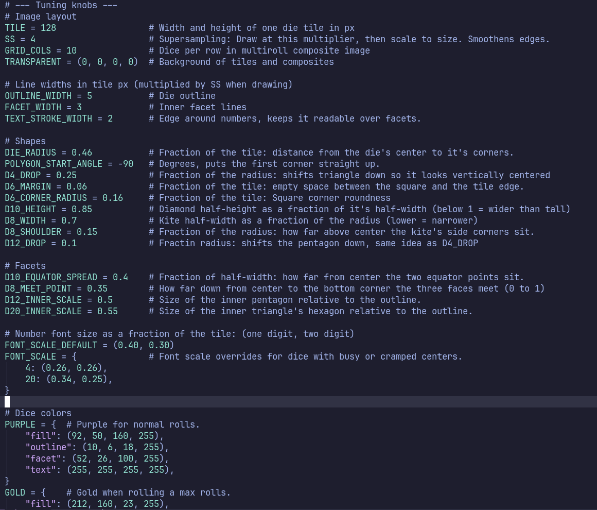

# My personal (work in progress) DnD helper Discord bot

## Features

- Rolls all the different kinds of dice my group uses and renders them with Pillow.
- Able to roll multiple of the same dice at once using the multiroll command.
- Rolls initiative for a fixed party, with character names and DEX modifiers kept in a local
  `party.py`.
- Different color die for low and maximum rolls.
- Thoroughly commented and explained code.
- Capable of sending quotes to a channel of your choice. Quotes live in a local `quotes.py`, copied
  from `quotes_example.py`. (off by default)

## Usage

As long as someone in the Discord server you're in is hosting it (see deploying and modifying
section), you'll have access to the following slash commands:



### What do they do?

The names are pretty self-explanatory. Each command rolls its respective die, renders it with Pillow
and sends the rendered image. Here is what they look like.

**D4:**


**D6:**


**D8:**


**D10:**


**D12:**


**D20:**


### Multiroll

Multiroll rolls multiple of the given die. The image is a collage of all rolls and the total of the
rolls is in the message text. You may think that rolling multiple dice would start struggling with
efficiency issues, however each die tile is cached and can be reused during the bot's activity. To
show what multiroll looks like in practice, we'll roll 4 D20s:




Nice! We rolled both a nat20 (max roll) and a nat1 (minimum roll)! This is a perfect display of the
max and low roll color changes! Pretty neat, right?

### Initiative

`/initiative` rolls one d20 for every character in your `party.py` and replies with a plain text
list in turn order, for example:



Each line is `character: total (+DEX)`, nat 20s and nat 1s show as `NAT20` and `NAT1` respectively
instead of the total. Ordering is done based on the total (d20 + DEX), except a nat 20 always goes
first and a nat 1 always goes last. Tied totals go to the higher DEX modifier and if they're still
tied it's randomized. The order is only shown once and is not stored between commands.

## Deploying and modifying

### Deploying

You want to be the friend to host a fun little bot? It's pretty easy! Here is a step by step guide:

1. Go to [discord.com/developers/applications](https://discord.com/developers/applications) and
   create an app with the name of your choice.

2. Go to the **installation** section of your app, give it the **Guild Install installation context
   method**. In default install settings under guild install, give it the **application.commands**
   scope. You also should grab the **installation link.**

3. In the bot section, give it the name of your choice and tick Public Bot on to make installation
   for you and your friends easy, though keep in mind to not share the link if this is on. Finally,
   grab the bot token. **DO NOT SHARE THIS WITH ANYONE, KEEP IT SAFE!**

4. Use the installation link to invite the bot to the server(s) of your choice.

The Discord side of things is now out of the way, now the more technical stuff:

5. Install the bot in your preferred way:

5a. Using Git (Requires git to be installed):

```console
cd <directory of choice>
git clone https://github.com/Crendial/dndBot.git
```

5b. Download the zip:

- Click the green **Code** button at the top of this repository

- Click **Download ZIP**

- Unzip the file, put its contents into the directory of your choice.

6. Create your virtual environment (You need python version 3.10-3.14):

- Create a venv (Debian/Ubuntu users may need to install python3-venv separately):

```console
cd <directory containing bot.py and requirements.txt>
python -m venv <path-to-venv>
```

Then activate it using the line for your system:

```console
# Linux/macOS (bash/zsh)
source <path-to-venv>/bin/activate

# Linux/macOS (fish)
source <path-to-venv>/bin/activate.fish

# Windows (CMD)
<path-to-venv>\Scripts\activate.bat

# Windows (PowerShell)
<path-to-venv>\Scripts\Activate.ps1

```

(If the command 'python' doesn't exist, try python3 or py instead. If both fail, Python may not be
installed or is missing from your PATH)

And then install dependencies:

```console
pip install -r requirements.txt
```

Keep the console you used to activate the venv in the background, you'll need it soon!

7. Make a `.env`:

This repo provides a `.env.example` with two values:

- Make a copy of `.env.example` and name the copy `.env` (in the same directory as bot.py).

- `DISCORD_TOKEN` is required: replace `<The token you saved earlier>` with your actual bot token.
  Never commit or share your `.env`.

- `YAPPER_CHANNEL` is only needed if you enable Yapper (see [Modifying](#modifying)). Replace
  `<The channel you want quotes to go into>` with the numeric ID of the channel the bot should post
  in: enable Developer Mode in Discord, then right-click the channel and choose Copy ID. If Yapper
  stays off, you can leave the placeholder as-is because the bot ignores it.

- For `/initiative`, copy `party_example.py` to `party.py` and replace the placeholder names and
  modifiers with your party's. `party.py` is gitignored, so your real values stay local; without it,
  the bot uses the placeholders from `party_example.py`.

- For Yapper, copy `quotes_example.py` to `quotes.py` and replace the placeholders with your own
  quotes. `quotes.py` is gitignored; without it, the bot uses the placeholders from
  `quotes_example.py`.

8. You can run the bot!:

- Simply open the console you have the venv activated in and run

```console
python bot.py
```

(Remember, if you had to replace 'python' earlier, do the same here!)

Your console should print the following if everything worked:

```console
<bot name>#<numbers> has successfully connected to the cord!

```

To stop it, press Ctrl+C or close the console.

### Modifying

You can obviously do anything you want with the code, but I made changing a few things a lot easier
for you, mainly how the dice look:



Since the images are rendered on the fly, modifying how they end up is easy! I commented and
explained all the modifiable variables as well as die color blocks. Simply edit bot.py, change the
numbers around and see what happens! (I am not responsible for any changes breaking stuff ok?)

Yapper is off by default. To turn it on, set `YAPPER = True` in the "Random quotes function stuff"
section near the top of `bot.py`, then set `YAPPER_CHANNEL` in `.env` to the ID of the channel you
want quotes posted in. Add your own quotes to your local `quotes.py` (one string per entry) in place
of the placeholders from `quotes_example.py`, and change `MIN_TIME` / `MAX_TIME` (in seconds) in
`bot.py` to control how long the bot waits between quotes. The defaults are 5 seconds to 2 hours.
